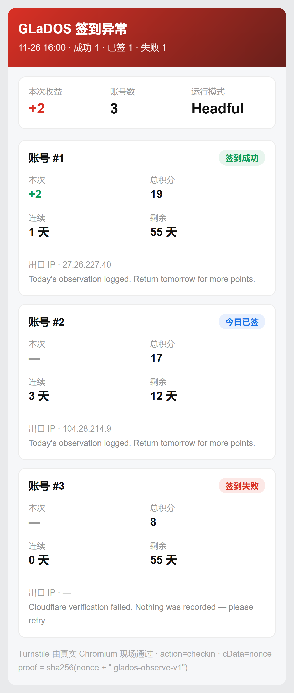

# Glados-Railgun-checkin

GLaDOS（Railgun）每日自动签到 + PushPlus 美化推送。

站点在 2026 年给签到接入了 **Cloudflare Turnstile**，原来的纯 `requests` 脚本会被判 `code=5 turnstile`。
本仓库改用 **Playwright 驱动真实 Chromium** 现场通过 Turnstile，再按站点前端完全一致的算法提交签到。

---

## 1. 签到链路（逆向自站点前端）

```
GET  /api/user/checkin/challenge
     -> { code:0, nonce, ttl:300000, turnstile:"0x4AAAAAAFF5pkT0bg7fX7nw", ip }

Turnstile 组件（站点用 render 动态挂载）
     sitekey    = 上面的 turnstile 字段
     action     = "checkin"
     cData      = nonce
     appearance = "interaction-only"     # 正常情况下无需点击，自动通过

POST /api/user/checkin
     body = { token: location.hostname, nonce, proof, tsState, turnstile }
     proof = sha256(nonce + ".glados-observe-v1")   # hex
```

`proof` 的密钥 `glados-observe-v1` 来自站点 JS 里的字符码数组
`[103,108,97,100,111,115,45,111,98,115,101,114,118,101,45,118,49]`。

服务端返回码：

| code | reason | 含义 |
|---|---|---|
| 0 | – | 签到成功，`points` 为本次收益 |
| 1 | – | 今日已签（`repeated: true`），不会重复计分 |
| 4 | `device-mismatch` | 当前 UA 与登录设备不一致，返回 `loginDevice` / `currentDevice` |
| 5 | `turnstile` | Cloudflare 校验未通过，`retryable: true`，**什么都没记录** |

> `code=5` 不会写入任何记录，所以可以安全重试。脚本默认重试 3 次。

---

## 2. 两种引擎（关键）

Cloudflare Turnstile 是**反自动化**组件，token 只能由真实、非自动化的浏览器产生。实测：

| 运行环境 | 引擎 | 结果 |
|---|---|---|
| 本地真实桌面（Windows/macOS） | browser（headful） | ✅ 自动通过，签到成功 |
| GitHub 托管 runner（无 GPU 虚拟机） | browser（headful） | ❌ widget 不完成，`code=None` |
| 任意环境 | browser（headless） | ❌ `tsState=error`，`code=5 turnstile` |

因此脚本提供 **两个引擎**：

### 引擎 A：`api`（CI 推荐）

纯 HTTP，不需要浏览器：先由**Turnstile 求解服务**拿 token，再按前端同样的算法提交。

```
challenge -> 求解服务(sitekey + pageurl + action=checkin + cdata=nonce) -> token
          -> proof = sha256(nonce + ".glados-observe-v1") -> POST /api/user/checkin
```

支持 `capsolver` / `yescaptcha` / `2captcha`。内置 **UA 自动对齐**：遇到 `code=4 device-mismatch`
会读取 `loginDevice` 并自动切换到对应系统 UA 重试，所以 Windows / Android / iOS / macOS 的 cookie 都能用。

### 引擎 B：`browser`（本地 / 自建 runner 推荐）

Playwright 驱动真实 Chromium（headful）现场通过 Turnstile，**只有在真实桌面环境才有效**。

> 选择逻辑：配置了 `TURNSTILE_PROVIDER` + `TURNSTILE_API_KEY` 走 `api`，否则走 `browser`。

## 3. 三种落地方式

| 方案 | 成本 | 稳定性 | 说明 |
|---|---|---|---|
| **① 求解服务 + GitHub Actions** | 约 ¥0.01~0.05/次 | ⭐⭐⭐⭐⭐ | 推荐，配两个 secret 即可 |
| **② 自建 runner（自己的电脑/NAS/软路由）** | 免费 | ⭐⭐⭐⭐⭐ | 用 `gladosCheck.selfhosted.yml`，真实桌面，browser 引擎必过 |
| **③ GitHub 托管 runner + browser 引擎** | 免费 | ⭐ | 实测过不了 Turnstile，**不推荐** |

### 自建 runner 怎么跑

1. 仓库 **Settings → Actions → Runners → New self-hosted runner**，按提示在目标机器
   （Windows 桌面 / macOS，需有真实图形会话）上执行 `config.cmd`，标签保持默认；
2. 仓库里启用 `.github/workflows/gladosCheck.selfhosted.yml`（默认只允许手动触发，
   想定时就把文件里的 `schedule` 取消注释，并停用 `gladosCheck.yml` 的定时）；
3. 该工作流用 `runs-on: [self-hosted, Windows, X64]` + 系统 Chrome，headful 直跑。

> 为什么免费方案里只有自建 runner 靠谱：Turnstile 判定的是**真实浏览器环境**
> （GPU、渲染、输入事件、指纹自洽），托管 runner 的虚拟机在这几项上都露馅。

## 4. device-mismatch 说明

站点把**登录设备**与**当前设备**比对，依据是 UA 里的操作系统：

```
code=4 reason=device-mismatch  loginDevice=Android  currentDevice=Windows
```

- `api` 引擎会按 `loginDevice` 自动切换 UA；
- `browser` 引擎要求运行环境与登录设备一致（如都用 Windows 桌面 Chrome）。

---

## 5. 部署（GitHub Actions）

1. Fork 本仓库。
2. 仓库 **Settings → Secrets and variables → Actions → New repository secret**：

   | Secret | 必填 | 说明 |
   |---|---|---|
   | `GLADOS_COOKIES` | ✅ | 一个或多个账号的 Cookie，多账号用 `&` 连接 |
   | `PUSHPLUS_TOKEN` | 建议 | PushPlus token，不填则只打日志 |
   | `TURNSTILE_PROVIDER` | 推荐 | `capsolver` / `yescaptcha` / `2captcha` |
   | `TURNSTILE_API_KEY` | 推荐 | 求解服务的 API Key |

   > 不配 `TURNSTILE_*` 时走浏览器引擎；GitHub 托管 runner 上过不了 Turnstile（见第 2 节）。

3. **Actions → auto check → Run workflow** 手动跑一次，确认日志出现
   `返回 code=0/1` 与 `PushPlus 推送成功`。
4. 之后按 `cron: '18 1,4 * * *'`（北京时间 09:18 / 12:18）自动执行。

### 求解服务怎么配

以 CapSolver 为例：注册后在后台拿 `clientKey`，然后：

```
TURNSTILE_PROVIDER = capsolver
TURNSTILE_API_KEY  = CAP-xxxxxxxxxxxxxxxx
```

YesCaptcha / 2Captcha 同理，把 provider 换成对应名字即可（脚本已内置三家的 createTask/getTaskResult 流程）。

### Cookie 怎么取

1. 桌面版 Chrome 打开 <https://glados.space/console> 并登录；
2. `F12` → **Network** → 刷新页面 → 点任一 `glados.space` 请求；
3. **Request Headers → Cookie**，复制 `gld:sess=...; gld:sess.sig=...; gld:accts=...; gld:accts.sig=...`；
4. 多账号：每个账号单独按上面步骤取一份，用 `&` 拼成一行。

```
gld:sess=AAA; gld:sess.sig=BBB; gld:accts=CCC; gld:accts.sig=DDD&gld:sess=EEE; gld:sess.sig=FFF; ...
```

---

## 6. 环境变量

| 变量 | 默认 | 说明 |
|---|---|---|
| `GLADOS_COOKIES` | – | 必填，cookie 串，多账号用 `&` 分隔 |
| `PUSHPLUS_TOKEN` | – | PushPlus token |
| `TURNSTILE_PROVIDER` | – | 求解服务：`capsolver` / `yescaptcha` / `2captcha`（配置后走 api 引擎） |
| `TURNSTILE_API_KEY` | – | 求解服务 API Key |
| `GLADOS_HEADLESS` | `0` | browser 引擎必须 `0`；`1` 会因 Turnstile 拿不到 token 失败 |
| `GLADOS_RETRY` | `3` | browser 引擎失败重试次数 |
| `GLADOS_BROWSER_CHANNEL` | – | 本地可设 `chrome` 用系统 Chrome；CI 留空用 Playwright 自带 Chromium |

---

## 7. 本地运行

```bash
pip install -r requirements.txt
python -m playwright install chromium

# Windows PowerShell（browser 引擎）
$env:GLADOS_COOKIES = "gld:sess=...; gld:sess.sig=..."
$env:PUSHPLUS_TOKEN  = "your_token"
python checkin.py

# 或者用 api 引擎（无需浏览器）
$env:TURNSTILE_PROVIDER = "capsolver"
$env:TURNSTILE_API_KEY  = "CAP-xxxx"
python checkin.py
```

Linux 无桌面时（browser 引擎）：

```bash
xvfb-run -a --server-args="-screen 0 1440x900x24" python checkin.py
```

---

## 8. 推送效果

采用**手机优先**布局（PushPlus 主要在微信内置浏览器查看）：账号卡片式排列，
四宫格指标、状态徽标、出口 IP 与原始返回信息分层展示，窄屏不会挤成一条缝。



---

## 9. 常见问题

**Q: 日志出现 `code=None`（一直没有 POST）**
浏览器引擎里 Turnstile widget 没完成。看日志里那行 `Turnstile 资源加载异常`：

- 出现 `400 .../cdn-cgi/challenge-platform/...`：**当前出口 IP 被 Cloudflare 限流**。
  这是最常见的故障——同一个 IP 在 Cloudflare 眼里“可疑”时，challenge 端点直接 400，
  widget 不会渲染，签到请求根本发不出去。换网络（家宽 ↔ 手机热点）、
  换代理出口、等几小时后冷却，或改用 `api` 引擎（求解服务自带干净出口）。
  用第三方 Turnstile 演示页（如 `nopecha.com/demo/turnstile`）也能复现 400，
  说明与本脚本、与 glados 都无关。
- 出现 `failed net::ERR_...`：本地网络/代理/DNS 拦了 `challenges.cloudflare.com`。
- 什么都没打印：页面没加载完，检查 cookie 是否已失效。

**Q: 日志出现 `code=5 reason=turnstile`**
Turnstile 没通过（此时说明设备检查已通过，只差 token）。若用的是 `api` 引擎，
多为求解服务 token 与本站参数/IP 不匹配，换 provider 或换线路；
若用 `browser` 引擎，同上先排查 IP 限流。

**Q: 日志出现 `code=4 reason=device-mismatch`**
`api` 引擎会自动切换 UA 重试；若仍失败，看日志里的 `loginDevice`，确认对应 UA 配置文件存在。
`browser` 引擎则需运行环境与登录设备一致。

**Q: 日志出现 `code=1 repeated: true`**
今天已经签过了，属于正常情况，不会重复加分。

**Q: 登录页能打开但按钮一直不出现**
cookie 失效（被登出）。重新登录拿新 cookie。

---

## 10. 变更说明

- **2026-11-26**：适配 Cloudflare Turnstile。
  - 新增 `engine_api.py`：Turnstile 求解服务（capsolver/yescaptcha/2captcha）+ 纯 HTTP 提交，
    并自动对齐 `loginDevice` 的 UA（解决 `device-mismatch`）；
  - `checkin.py` 保留 Playwright 浏览器引擎（真实桌面可用），按环境变量自动选择引擎；
  - 按前端算法补上 `proof = sha256(nonce + ".glados-observe-v1")`；
  - 推送后端改为 PushPlus，手机优先卡片式排版；
  - 工作流改为 `ubuntu-latest`，有求解服务走 api 引擎，否则回退 xvfb + 浏览器引擎。

## 免责声明

仅供个人账号自动签到使用。请遵守站点服务条款，脚本自负风险。